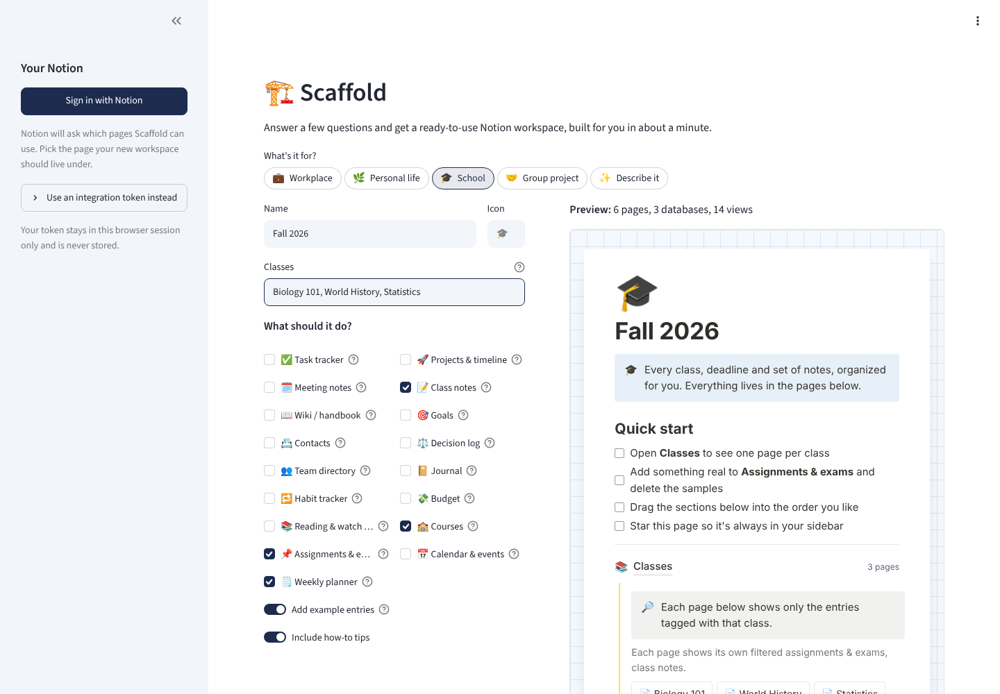
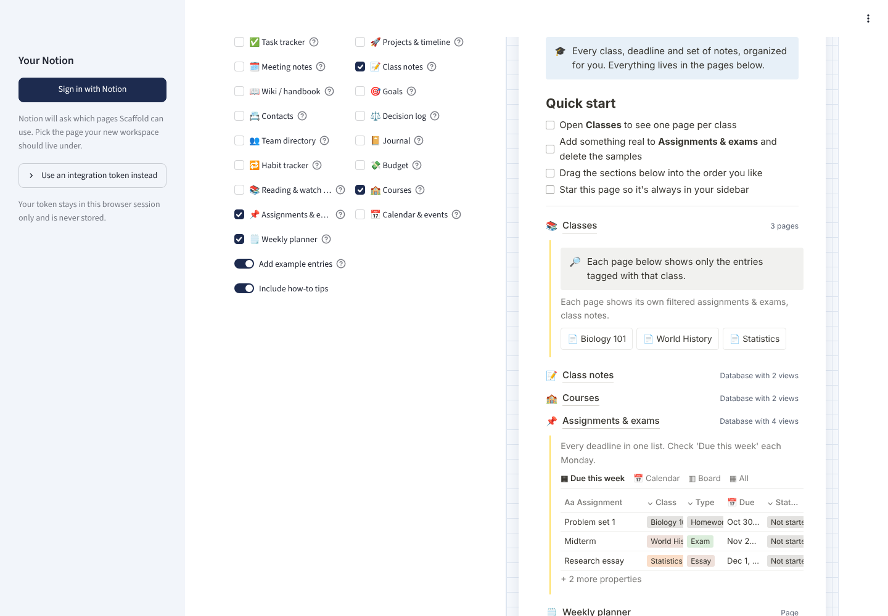

# 🏗️ Scaffold

**Answer a few questions and get a ready-to-use Notion workspace, built for you in about a minute.**

Setting up Notion well takes hours: deciding on databases, wiring up views, making it look
like something you'd actually use. Scaffold asks what the workspace is for, what your
sub-categories are (classes, teams, areas of life) and what it should do. Then it builds the
whole thing in your Notion: pages, databases, board, calendar and timeline views, example
entries, and one page per category that shows only that category's work.



## What it builds

Pick a starting point and Scaffold suggests the right pieces. You can mix in any of 17 others.

| For | Suggested | Your categories become |
|---|---|---|
| 💼 Workplace | Tasks, projects with a timeline, meeting notes, wiki, goals | Teams |
| 🌿 Personal life | Tasks, habit tracker, journal, budget, reading list | Life areas |
| 🎓 School | Courses, assignments & exams, class notes, weekly planner | Classes |
| 🤝 Group project | Team directory, tasks with assignees, meetings, decision log, notes | Workstreams |
| ✨ Describe it | Whatever you describe in your own words (AI) | Whatever you mention |

The category pages are the part people like most. Type `Biology 101, World History, Statistics`
and you get a **Classes** page with one page per class. Each class page shows a filtered view of
your assignments and notes for just that class, while everything still lives in one database.



## How it works

```
form answers ─┐
              ├─▶ Request ─▶ Blueprint ─┬─▶ preview (no Notion needed)
AI (Claude) ──┘              (validated) ├─▶ download as JSON
                                         └─▶ Notion API: pages → databases → views → entries
```

- **Blueprint first, API second.** Every workspace is first described as a plain *blueprint*:
  pages, databases, properties, views and example rows. It's validated before anything touches
  your Notion, so problems get caught up front instead of halfway through a build.
- **AI that can't break things.** In *Describe it* mode, Claude fills in the same form you
  would. It chooses from the tested feature library and only designs a custom database when
  nothing fits. Its output is repaired and validated like everything else. A board grouped by a
  text column, a second title property or a calendar without a date all get fixed or dropped
  before they reach the API.
- **Built for Notion's current API** (version `2026-03-11`): databases with data sources, the
  Views API for board, calendar and timeline tabs, and linked database views filtered per category.
- **Polite to Notion's servers.** Calls are spaced to stay under the rate limit, retried with
  backoff on `429` and `5xx`, and long pages are sent in chunks of 100 blocks.
- **Forgiving.** If one view fails, the build continues and lists what didn't work instead of
  failing the whole thing.

## Sign in with Notion

Scaffold uses Notion's OAuth flow for public integrations. One tricky part: Streamlit starts a
fresh session when the browser comes back from Notion, which would erase everything the person
typed. Instead, their answers travel inside the OAuth `state` parameter, compressed, timestamped
and **HMAC-signed** with the client secret. Tampered or stale states are rejected, which also
covers CSRF protection, and no server-side storage is needed.

Tokens live only in the browser session and are never stored or logged.

## Run it

```bash
git clone https://github.com/gravewar/notion-scaffold.git
cd notion-scaffold
pip install -r requirements.txt
streamlit run app.py
```

The form and preview work right away with no setup. To build into Notion, either:

- **Paste a token (easiest):** create an internal integration at
  [notion.so/profile/integrations](https://www.notion.so/profile/integrations), copy its secret
  into the sidebar, and share a page with it (in Notion, **••• → Connections**).
- **Sign in with Notion:** create a *public* integration, then copy
  `.streamlit/secrets.example.toml` to `.streamlit/secrets.toml` and fill in its client ID,
  secret and redirect URI.

For *Describe it* mode, add an `ANTHROPIC_API_KEY` to the same secrets file.

## Testing

```bash
pip install -e ".[dev]"
pytest                                   # 33 tests
cd tests/typecheck && npm install && python dump_payloads.py > payloads.ts && npx tsc
```

- **A fake Notion** (`tests/fake_notion.py`) enforces the rules the real API rejects on:
  100-block limits, nesting depth, one title property, commas in select options, valid view
  configurations, and properties that actually exist. Every context and feature combination
  is deployed against it.
- **Type-checked against Notion's official SDK.** Every request body Scaffold can send (340 of
  them across all templates) is written into a TypeScript file typed with `@notionhq/client`, and
  `tsc` checks them against Notion's own API definitions. CI runs this on every push.
- **End to end in a browser.** `tests/fake_server.py` serves the fake over HTTP, including
  a working OAuth authorize and token endpoint, so the whole flow can be clicked through:
  fill in the form, sign in, come back with the answers intact, build.

## Project layout

```
app.py                 Streamlit app
scaffold/
  blueprint.py         the blueprint format, validation and auto-repair
  library.py           the 17 building blocks and 4 starting points
  compose.py           answers → blueprint
  ai.py                plain-English description → answers (Claude, via tool use)
  render.py            blueprint → Notion API request bodies (pure functions)
  notion_api.py        small Notion client with rate limiting and retries
  deploy.py            runs the build, with progress updates
  oauth.py             Sign in with Notion, with signed state
  preview.py           blueprint → HTML preview of the finished page
tests/                 unit tests, fake Notion, fake server, SDK type-check
```

## Roadmap

- [ ] Relations between databases (link assignments to their course row, not just a tag)
- [ ] Save and share blueprints as templates, so you can make one and send it to your group
- [ ] Edit the plan by hand before building (rename properties, reorder sections)
- [ ] More starting points: job hunt, wedding planning, content calendar

## License

MIT © Danielle Burns
